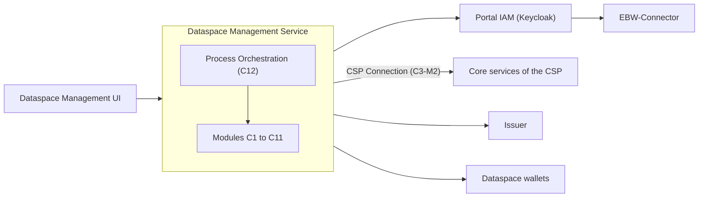

# Eclipse Tractus-X Dataspace Management Service

[](LICENSE)
[](LICENSE_non-code)
[](https://github.com/eclipse-tractusx/dataspace-mgm-service/actions/workflows/docker-build.yml)
[](https://github.com/eclipse-tractusx/dataspace-mgm-service/actions/workflows/codeql.yml)
[](https://github.com/eclipse-tractusx/dataspace-mgm-service/actions/workflows/kics.yml)
[](https://github.com/eclipse-tractusx/dataspace-mgm-service/actions/workflows/trivy.yml)
[](https://github.com/eclipse-tractusx/dataspace-mgm-service/actions/workflows/trufflehog.yml)

The **Dataspace Management** is the modernised portal of Eclipse Tractus-X. This repository holds its backend, the
**Dataspace Management Service**: a modular monolith in Python 3.12 and FastAPI with which an onboarding service provider
(OSP) registers, reviews and onboards companies to a dataspace such as Catena-X, and manages their people, technical
users, credentials, connectors, offers and subscriptions afterwards.

> **Status:** the code base of the Tractus-X Hackathon II scaffold is in the repository: every module of the
> specifications in [tx-arena-events/portal-backend-spec](https://github.com/tx-arena-events/portal-backend-spec) is
> mounted as a stand-in that a team replaces with its implementation. Hackathon teams start with the
> [developer guide of the scaffold](docs/developers/hackathon-scaffold.md) and the rules for coding agents in
> [AGENTS.md](AGENTS.md).

## Leading product repository

This is the leading repository of the product **Dataspace Management** (TRG 2.04). It contains the product Helm chart,
the release of the product and the architecture and admin documentation.

- [dataspace-mgm-service](https://github.com/eclipse-tractusx/dataspace-mgm-service): backend (this repository)
- [dataspace-mgm-ui](https://github.com/eclipse-tractusx/dataspace-mgm-ui): user interface and end user manual

## What it does

Today's portal is a monolith: the user interface owns orchestration and business rules, and a third party cannot use a
capability without the portal UI. The Dataspace Management splits the portal into modules with clear interfaces and
makes these interfaces the only way in. No single party runs the portal for all participants of a dataspace (OSP 2.0):

- **Every OSP runs its own installation**: all modules, Process Orchestration, databases, its own Portal IAM, its own
  EBW-Connector and its own UI. Its Helm chart decides which services it runs itself and which it uses from the CSP.
- **The core service provider (CSP) provides trust**: the trust list of admitted OSPs and issuers, the company identifier
  (BPN) with the home OSP of each company, the directory BPN → DID and discovery.
- **Sign-in without passwords**: people sign in with their EUDI Wallet; the Business Wallet of the company proves the
  company and the mandate of the person. The EBW-Connector checks both.



### Modules

| Capability | Modules |
|---|---|
| C1 Registration and review | C1-M2 Registration, C1-M3 Application Review |
| C2 People and access | C2-M2 Users and App Access, C2-M3 Technical Users, C2-M5 Portal IAM (configuration) |
| C3 Company | C3-M1 Company Profile, C3-M2 CSP Connection |
| C4 Credentials and wallets | C4-M1 Credentials, C4-M2 Dataspace Wallet Interface |
| C5 Wallet sign-in | C5-M1 EBW-Connector (provided, runs on its own) |
| C6 to C11 | C6-M1 Connectors, C8-M1 Offers, C10-M1 Subscriptions, C11-M1 Notifications |
| C12 Orchestration | C12-M1 Process Orchestration |

See the [building block view](docs/architecture/05_building_block_view.md) for the purpose of every module.

## Repository structure

| Path | Content |
|---|---|
| [`charts/dataspace-mgm`](charts/dataspace-mgm) | Product Helm chart: backend and UI of one installation |
| [`docs/architecture`](docs/architecture/README.md) | Architecture documentation (arc42) |
| [`docs/admin`](docs/admin/README.md) | Administrator guide |
| [`docs/api`](docs/api/README.md) | Interface documentation (OpenAPI) |
| [`Dockerfile`](Dockerfile), [`DOCKER_NOTICE.md`](DOCKER_NOTICE.md) | Container image and its notice for DockerHub |
| [`.github`](.github) | Workflows (build, Helm test and release, CodeQL, KICS, Trivy, TruffleHog, Eclipse Dash), Dependabot, templates |
| [`.tractusx`](.tractusx) | Metadata file for the Tractus-X release checks |
| [`portal_common/`](portal_common) | Shared building blocks: tokens, Problem Details, settings, neighbours, events, SSE, stand-ins |
| [`modules/<module>/`](modules) | One folder per module of the spec (`interface.py`, `router.py`) |
| [`scaffold/`](scaffold) | The installation app (`create_app`) and the module registry |
| [`config/`](config) | Settings and module configuration per installation (OSP A, OSP B) |
| [`iam/`](iam/README.md), [`ebw/`](ebw/README.md) | Test Portal IAM (Keycloak) and the EBW stack for tests with a real wallet |
| [`tools/`](tools), [`testdata/`](testdata), [`tests/`](tests) | Test tools, test data (FRAMEWORK 7a) and tests |
| [`demo.py`](demo.py), [`check.py`](check.py) | Acceptance demo of scenarios 1 to 4 and the setup check |
| `spec/` | Clone of the module specifications, read at start-up (not committed) |

## Installation

The product is installed with Helm:

```shell
helm repo add tractusx-dev https://eclipse-tractusx.github.io/charts/dev
helm install dataspace-mgm tractusx-dev/dataspace-mgm --namespace dataspace-mgm --create-namespace
helm test dataspace-mgm --namespace dataspace-mgm
```

The default values start a self-contained demo installation. [INSTALL.md](INSTALL.md) describes the installation step by
step, the [admin guide](docs/admin/README.md) the configuration of an operated installation, and the
[chart README](charts/dataspace-mgm/README.md) every value.

## Usage

Once the installation runs, the interface of every module is available under `/api/<module>` (a migrated feature under its readable name,
for example `/api/registration`), documented with Swagger UI
at `/docs`:

```shell
kubectl --namespace dataspace-mgm port-forward svc/dataspace-mgm-backend 8000:8000
curl http://localhost:8000/health
# {"status":"UP","osp":"OSP A"}
```

People use the installation through the [Dataspace Management UI](https://github.com/eclipse-tractusx/dataspace-mgm-ui);
third-party applications call the same interfaces with a token of the Portal IAM. The first flow is the onboarding of a
company: sign in with the EUDI Wallet, register the company with the Business Wallet, review by OSP staff, then
registration at the CSP, dataspace wallet and credentials (see the [runtime view](docs/architecture/06_runtime_view.md)).

### Local development

```shell
git clone https://github.com/tx-arena-events/portal-backend-spec.git spec   # read-only, not committed
uv sync                    # Python 3.12 and the dependencies
uv run pytest -q           # all tests
docker compose up -d       # test Portal IAM (Keycloak)
uv run python demo.py      # CSP stand-in, OSP A and OSP B, scenarios 1 to 4; exit code 0 = green
uv run uvicorn --factory scaffold.app:create_app --port 8000
```

`uv run python check.py` checks the whole setup. The [developer guide of the scaffold](docs/developers/hackathon-scaffold.md)
explains the modules, the call convention, the test data and how a team replaces its module.

## Documentation

| Document | Content |
|---|---|
| [docs/README.md](docs/README.md) | Overview of the documentation |
| [Hackathon scaffold](docs/developers/hackathon-scaffold.md) | Developer guide: modules, call convention, test data, demo |
| [Architecture](docs/architecture/README.md) | arc42: context, modules, flows, deployment, decisions |
| [Admin guide](docs/admin/README.md) | Configuration, secrets, operation, upgrade |
| [API](docs/api/README.md) | OpenAPI per module and of the installation |
| [User manual](https://github.com/eclipse-tractusx/dataspace-mgm-ui/blob/main/docs/user/README.md) | End user manual (in the UI repository) |
| [CHANGELOG.md](CHANGELOG.md) | Changes per release |

## Container images

The images are published on DockerHub: [`tractusx/dataspace-mgm-service`](https://hub.docker.com/r/tractusx/dataspace-mgm-service).
They are tagged with the semantic version of the release (`1.2.3`, `1.2`, `1`) and `latest` (TRG 4.01).
See the [notice for the Docker image](DOCKER_NOTICE.md) (TRG 4.06).

## Troubleshooting and FAQ

**Which installation do I get with the default values?**
A demo installation: OSP A of the hackathon scenario with an in-memory Portal IAM, a built-in CSP stand-in and test
doubles. It is meant for trying the product, not for operation; see the [admin guide](docs/admin/README.md).

**Where is the data stored?**
For now in memory: a restart starts with empty data, and only one backend replica can run. One PostgreSQL database per
module is planned.

**Every call answers 401.**
The token does not come from the Portal IAM of this installation, or its audience is not `portal-core`. Check
`backend.iam.*` in the values.

More problems and solutions are listed in [INSTALL.md](INSTALL.md#troubleshooting).

## Contributing

Contributions are welcome. Please read [CONTRIBUTING.md](CONTRIBUTING.md) first: you need to sign the Eclipse
Contributor Agreement, and pull requests follow conventional commits. Please report security vulnerabilities as
described in [SECURITY.md](SECURITY.md), never in public issues.

## Contact

- Mailing list: [tractusx-dev@eclipse.org](https://accounts.eclipse.org/mailing-list/tractusx-dev)
- Matrix chat: [Eclipse Tractus-X](https://matrix.to/#/#tractusx:matrix.eclipse.org)
- Issues: [GitHub issues](https://github.com/eclipse-tractusx/dataspace-mgm-service/issues)
- Committers: see [AUTHORS.md](AUTHORS.md) and [CODEOWNERS](.github/CODEOWNERS)

## License

Distributed under the [Apache License 2.0](LICENSE) for code and the
[Creative Commons Attribution 4.0 International](LICENSE_non-code) license (CC-BY-4.0) for non-code.
See [NOTICE.md](NOTICE.md) for more information. The third-party dependencies and their license status are listed in
the `DEPENDENCIES` file, generated with the Eclipse Dash License Tool.

## NOTICE

This work is licensed under the [CC-BY-4.0](https://creativecommons.org/licenses/by/4.0/legalcode).

- SPDX-License-Identifier: CC-BY-4.0
- SPDX-FileCopyrightText: 2026 Contributors to the Eclipse Foundation
- Source URL: https://github.com/eclipse-tractusx/dataspace-mgm-service
