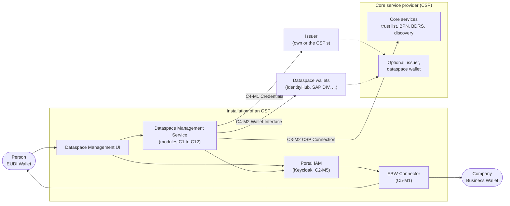

# 3. Context and scope

## 3.1 Business context

Every OSP runs its own installation of the Dataspace Management. The CSP runs the central core services and provides trust.

| Neighbour | Interface |
|---|---|
| People (applicants, company administrators, OSP staff) | Dataspace Management UI, signed in with the EUDI Wallet through the Portal IAM and the EBW-Connector |
| Core services of the CSP | OSP–CSP interface, called only by C3-M2 CSP Connection |
| Issuers | Issuance and revocation of BPN and membership credentials, called by C4-M1 Credentials |
| Dataspace wallets | Wallet per company and wallet accounts for technical users, called by C4-M2 Dataspace Wallet Interface |
| Third-party applications | The same HTTP interfaces as the UI (OpenAPI per module) |

## 3.2 Technical context

- The UI calls the service over HTTPS; the browser holds only a session cookie, no tokens (see the
  [frontend architecture](https://github.com/eclipse-tractusx/dataspace-mgm-ui/blob/main/docs/architecture/README.md)).
- Live updates for the UI are Server-Sent Events (`.../events`), never WebSockets and never polling.
- Each module is reachable at `/api/<module>`, e.g. `/api/c12-m1` (FRAMEWORK 4.1); a migrated feature at its readable
  name, e.g. `/api/registration` (ADR-0003).
- Calls to the CSP use `private_key_jwt` with the signing key of the OSP.

## NOTICE

This work is licensed under the [CC-BY-4.0](https://creativecommons.org/licenses/by/4.0/legalcode).

- SPDX-License-Identifier: CC-BY-4.0
- SPDX-FileCopyrightText: 2026 Contributors to the Eclipse Foundation
- Source URL: https://github.com/eclipse-tractusx/dataspace-mgm-service/blob/main/docs/architecture/03_context_and_scope.md
