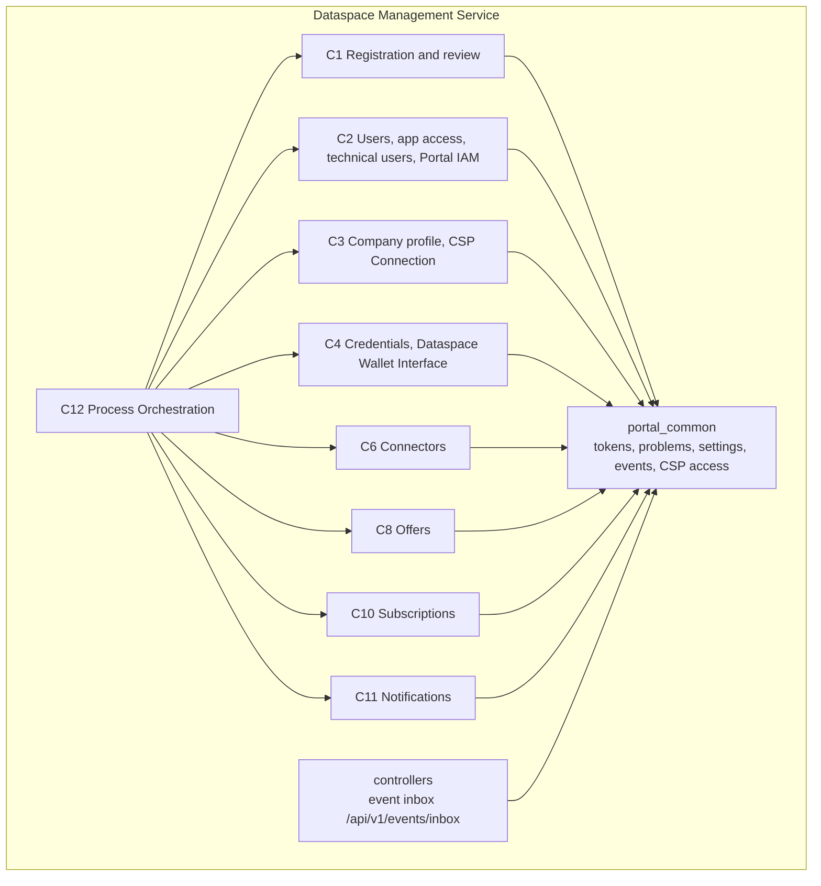

# 5. Building block view

## 5.1 Level 1: capabilities

## 5.2 Level 2: modules

| No. | Module | Purpose |
|---|---|---|
| C1-M2 | Registration | Application of a company at the OSP: data, verification attestation, consents, submission; reactivation and transfer |
| C1-M3 | Application Review | Review case per application, automatic pre-check (with duplicate check at the CSP), decision by OSP staff |
| C2-M2 | Users and App Access | Accounts of people without passwords, binding to a company, invitations, portal roles and app roles; client template and instance clients per app |
| C2-M3 | Technical Users | Technical users of companies (client with service account), wallet access as a property |
| C2-M5 | Portal IAM | Configuration: realm of the OSP, identity provider EBW-Connector, client `portal-core`, permissions and portal roles, token contents |
| C3-M1 | Company Profile | Record of the company in the installation, company identifier (BPN) from the CSP, company roles, status |
| C3-M2 | CSP Connection | Registers companies with the CSP (BPN, home OSP), duplicate check, membership, directory BPN → DID, connectors in the discovery, notifications from the CSP |
| C4-M1 | Credentials | Triggers, tracks and revokes BPN and membership credentials at the issuer; own issuer or the CSP's |
| C4-M2 | Dataspace Wallet Interface | Vendor-neutral: dataspace wallet per company, wallet accounts for technical users; adapter per provider |
| C5-M1 | EBW-Connector | Checks EUDI Wallet and Business Wallet via OpenID4VP; OpenID Connect for Portal IAM, UI and Business Wallet (provided, runs on its own) |
| C6-M1 | Connectors | Connectors of the companies and their entries in the discovery |
| C8-M1 | Offers | Apps and services of providers, approval by OSP staff |
| C10-M1 | Subscriptions | Subscriptions of companies to offers |
| C11-M1 | Notifications | Inbox of people in the portal |
| C12-M1 | Process Orchestration | Runs the flows of `flows.yaml` across the modules |

Dropped with OSP 2.0: C1-M1 PSP Admission, C2-M1 Sign-in Services, C2-M4 Delegation.

Each module folder contains:

| File | Content |
|---|---|
| `interface.py` | Public interface: operations, steps for Process Orchestration and queries for other modules |
| `router.py` | HTTP routes as described in the module's `openapi.yaml` |

APIs of the installation that belong to no module are in `controllers/`: one folder per API category and version,
as in the Industry Core Hub backend (`controllers/fastapi/routers/<category>/v1/<name>.py`), mounted under
`/api/v1`. The first is the event inbox `POST /api/v1/events/inbox`: split-out modules deliver their events there as
CloudEvents (structured or binary content mode, token of the service account of the publishing module; FRAMEWORK 6).

The specification of each module (behaviour, data, rules, operations, steps, queries, events, errors, acceptance
criteria and test data) is kept per module folder in the specification; see [docs/api](../api/README.md).

## NOTICE

This work is licensed under the [CC-BY-4.0](https://creativecommons.org/licenses/by/4.0/legalcode).

- SPDX-License-Identifier: CC-BY-4.0
- SPDX-FileCopyrightText: 2026 Contributors to the Eclipse Foundation
- Source URL: https://github.com/eclipse-tractusx/dataspace-mgm-service/blob/main/docs/architecture/05_building_block_view.md
