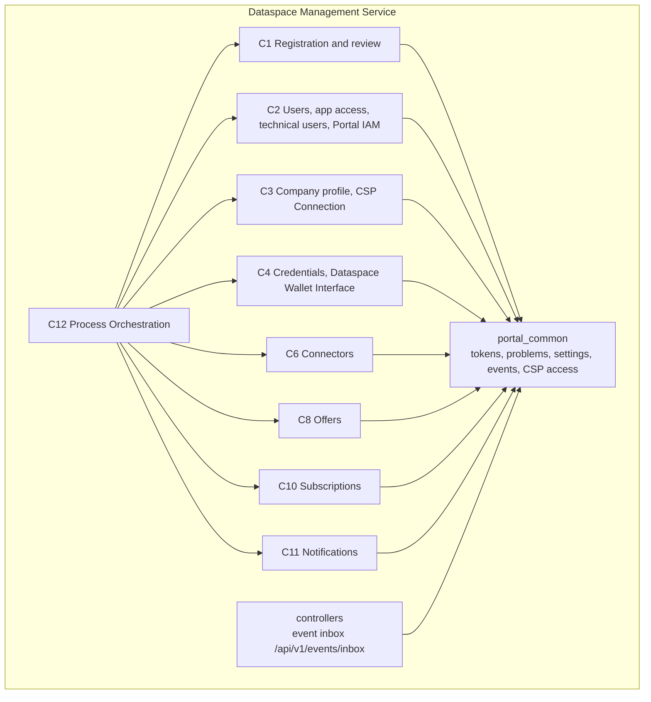

# 5. Building block view

## 5.1 Level 1: capabilities



## 5.2 Level 2: modules

| No. | Module | Purpose |
|---|---|---|
| C1-M2 | Registration | Application of a company at the OSP: data, verification attestation, consents, submission; reactivation and transfer |
| C1-M3 | Application Review | Review case per application, automatic pre-check (with duplicate check at the CSP), decision by OSP staff |
| C2-M2 | Users and App Access | Accounts of people without passwords, binding to a company, invitations, portal roles and app roles; client template and instance clients per app |
| C2-M3 | Technical Users | Technical users of companies (client with service account), wallet access as a property |
| C2-M5 | Portal IAM | Configuration: realm of the OSP, identity provider EBW-Connector, client `portal-core`, permissions and portal roles, token contents |
| C3-M1 | Company Profile | Record of the company in the installation, company identifier (BPN) from the CSP, company roles, status |
| C3-M2 | CSP Connection | Registers companies with the CSP (BPN, home OSP), duplicate check, membership, directory BPN → DID, connectors in the discovery, notifications from the CSP |
| C4-M1 | Credentials | Triggers, tracks and revokes BPN and membership credentials at the issuer; own issuer or the CSP's |
| C4-M2 | Dataspace Wallet Interface | Vendor-neutral: dataspace wallet per company, wallet accounts for technical users; adapter per provider |
| C5-M1 | EBW-Connector | Checks EUDI Wallet and Business Wallet via OpenID4VP; OpenID Connect for Portal IAM, UI and Business Wallet (provided, runs on its own) |
| C6-M1 | Connectors | Connectors of the companies and their entries in the discovery |
| C8-M1 | Offers | Apps and services of providers, approval by OSP staff |
| C10-M1 | Subscriptions | Subscriptions of companies to offers |
| C11-M1 | Notifications | Inbox of people in the portal |
| C12-M1 | Process Orchestration | Runs the flows of `flows.yaml` across the modules |

Dropped with OSP 2.0: C1-M1 PSP Admission, C2-M1 Sign-in Services, C2-M4 Delegation.

Each module folder contains:

| File | Content |
|---|---|
| `interface.py` | Public interface: operations, steps for Process Orchestration and queries for other modules |
| `router.py` | HTTP routes as described in the module's `openapi.yaml` |

APIs of the installation that belong to no module are in `controllers/`: one folder per API category and version,
as in the Industry Core Hub backend (`controllers/fastapi/routers/<category>/v1/<name>_api.py`), mounted under
`/api/v1`. The first is the event inbox `POST /api/v1/events/inbox`: split-out modules deliver their events there as
CloudEvents (structured or binary content mode, token of the service account of the publishing module; FRAMEWORK 6).

The specification of each module (behaviour, data, rules, operations, steps, queries, events, errors, acceptance
criteria and test data) is kept per module folder in the specification; see [docs/api](../api/README.md).

## 5.3 Proposed target: feature-first packages, composable runtimes

**Status: proposal for committer review, not the layout implemented in this checkout.**
This concept reconciles [PR #50](https://github.com/eclipse-tractusx/dataspace-mgm-services/pull/50)
(reviewed at `babf094ce69f7b190abf78cd8f4e602087a97036`) with
[issue #54](https://github.com/eclipse-tractusx/dataspace-mgm-services/issues/54), including the review by
@wahidulazam. The existing module and call-convention rules remain binding until their migration is approved.
The quality and rollout proposal is in [chapter 10](10_quality_requirements.md#101-proposed-common-quality-gate).

### Package, contract and deployment are different boundaries

- **Feature:** a business capability with a readable Python package name. Start with one feature per spec module:
  `registration` for C1-M2 and `company_profile` for C3-M1, as in PR #50. Do not invent further mappings silently.
- **Contract:** the existing module ID remains the identity for API paths, permissions, service accounts, Problem
  types, events and orchestration. Moving a package does not rename its external contract.
- **Runtime:** a composition root that hosts one or more features. Use a single installation by default; compose
  `registration` and `company_profile` into an onboarding runtime, or deploy each separately when justified.
  A runtime is not a new business layer and does not own feature data.

Keep the modular monolith as the simplest deployment. Feature-first organisation does not require microservices.
Splitting a runtime must preserve the same observable behaviour, authorisation and failure semantics.
Record the feature-name-to-module-ID mapping explicitly and validate its uniqueness. Do not derive stable Python
import paths from mutable spec display titles; a title change must not relocate an implementation.

### One internal vocabulary

Adopt PR #50's `controllers`, `services`, `managers` and `models`, not a second competing folder scheme.
Within `managers`, use names that reveal the boundary: repository, neighbour gateway or external adapter.
The following is a target shape, not a requirement to create empty files or a class for every operation:

```text
features/
  registration/
    __init__.py             # identity and lifecycle entry points
    interface.py            # public, spec-named steps and queries
    router.py               # mount the controller tree
    main.py                 # optional single-feature runtime entry point
    controllers/
      applications/
        __init__.py         # ITEM = "applicationId"
        controller.py       # relative paths only
        documents/
          __init__.py
          controller.py
    services/
      application_service.py
    managers/
      application_repository.py
      company_profile_gateway.py
    models/
      application.py        # internal domain values
      schemas.py            # HTTP request/response models
    errors.py               # factories for this contract's Problems
runtimes/
  installation.py
  onboarding.py
```

Services may split by use case as they grow. A small feature can use a single service or manager file.
Do not replace a large `interface.py` with an equally large `shared.py`, or fragment simple logic merely to meet
a line limit.

### Dependencies point inward

| Boundary | Responsibility and allowed dependencies |
|---|---|
| Controllers | HTTP input/output, authentication and scope checks; call their own services. No storage or neighbour access. |
| Public interface | Stable, typed facade for spec-named steps and queries; delegate to own services. No HTTP dependencies. |
| Services | Business rules and use cases; use own models, error factories and managers or injected ports. Never import controllers, router or runtime. |
| Managers | Persistence, neighbour gateways and external adapters. Use models and shared infrastructure, never services or controllers. |
| Models and errors | Domain values, boundary schemas and Problem factories. No dependency on services or managers; only HTTP schemas depend on Pydantic. |
| Runtime/lifecycle | Construct and inject dependencies, mount routers, register event handlers, open and close resources. No business rules. |

Controllers and the public interface are parallel entry points to services; controllers need not round-trip through
the public facade. Cross-feature access goes only through the target's public interface, via the shared neighbour
mechanism, never its services, managers or data. Queries use that mechanism; process steps remain orchestrated by C12.
Shared token checks, Problem conversion, settings, events, SSE and neighbour transport remain in `portal_common`.

Use explicit delegating `def`s in `interface.py` during migration: they preserve the current discovery tooling.
Re-exports proposed in PR #50 are deferred until discovery, module-map and interface tests support them equivalently.
Resolve relative imports using package context in the boundary checker; until that is available, use absolute
imports within feature subpackages to avoid the false positives identified in issue #54.

Use Python 3.12 annotations, precise collections and small domain dataclasses (immutable where appropriate).
Pydantic models validate HTTP boundaries; they are not persistence entities. Avoid `Any`, including nested
`list[Any]` and aliases; use `object` only for untrusted values that are narrowed before use. A checked recursive
JSON type is appropriate at the existing dict-based contract boundary; do not change public signatures gratuitously.
Use a `Protocol` when a store or external-system boundary actually has interchangeable implementations.
Do not create a protocol for every service or for a single in-memory implementation.

Factories in `errors.py` return shared `Problem` objects with spec-defined types and fields. Keep transport exception
conversion in the shared HTTP layer, not repeated in each feature. Avoid identifiers that shadow the `errors` module.

### HTTP is a validated contract

Retain PR #50's controller tree: folders mirror static URL segments, parent `ITEM` declares the resource parameter,
and endpoint paths are relative. Webhooks are controllers too. Extend `mount()` to set the spec's `operationId`
centrally, and reject conflicting overrides and duplicates. It already resolves operations and binds `x-permission`
in the reviewed PR; that alone does not ensure complete request and response schemas.
Fail startup for protected operations without an attached token/permission dependency; intentionally public
operations must be identified from the reviewed contract. Check resource ownership at the point of loading the
resource in every entry path, including in-process calls; HTTP permission binding alone is not an ownership check.

Declare typed request and response models from the reviewed spec, including aliases for camelCase JSON,
required fields, constraints and status codes. Keep internal naming idiomatic Python. Do not substitute unvalidated
`dict = Body(...)` or catch-all response objects for a known schema. Downloads, SSE, redirects and no-content
responses need explicit media types/status documentation rather than a fictitious JSON model.
Continue shared 400 Problem Details validation (not FastAPI's default 422), and preserve spec-defined field-error
shapes. Test both generated OpenAPI and actual responses: a schema comparison cannot prove runtime behaviour.

### State, adapters and lifecycle

Keep data owned by the feature corresponding to its spec module: no shared tables, cross-feature database joins
or repository imports. Gateways encapsulate neighbour queries and use shared addressing and service tokens.
Adapters encapsulate external providers, including token/DID validation where applicable.
Inject callback ports into stand-ins; they must not import services or write directly into another layer's store.
Register callbacks and acquire clients at lifecycle startup, not as import side effects; release them at shutdown.

An in-memory repository may support deterministic local tests and the demo; PostgreSQL is the persistent option.
Do not silently fall back to memory after a configured database fails, and do not present memory as production
durability. The C2-M2 default-store fix is a separate implementation prerequisite, not supplied by this concept.
The shared `DATABASE_URL` ambiguity needs a spec decision: propose per-module database settings, then change code
and deployment configuration together. Until approved, retain the spec's names rather than inventing new ones here.

Preserve CloudEvents and authenticated inbox delivery when splitting runtimes. PR #50's in-memory retry forwarding
is not a durable outbox. Production split deployment needs durable delivery, idempotent consumers, bounded retries,
timeouts and operational evidence; package migration alone does not meet that requirement.

## NOTICE

This work is licensed under the [CC-BY-4.0](https://creativecommons.org/licenses/by/4.0/legalcode).

- SPDX-License-Identifier: CC-BY-4.0
- SPDX-FileCopyrightText: 2026 Contributors to the Eclipse Foundation
- Source URL: https://github.com/eclipse-tractusx/dataspace-mgm-service/blob/main/docs/architecture/05_building_block_view.md
