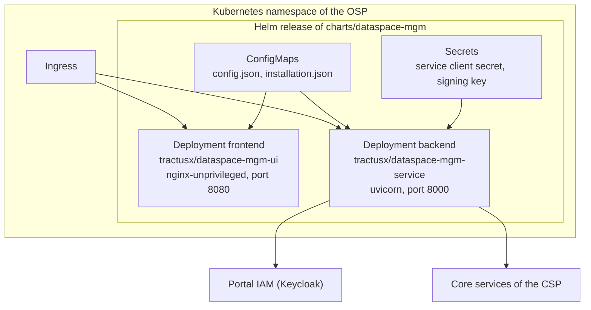

# 7. Deployment view

| Element | Description |
|---|---|
| Product Helm chart | [`charts/dataspace-mgm`](../../charts/dataspace-mgm) installs backend and UI of one installation (TRG 5.08). |
| Backend container | `tractusx/dataspace-mgm-service`, built from the [Dockerfile](../../Dockerfile) on `python:3.12-alpine`, runs as user 10001 with a read-only root file system. |
| UI container | `tractusx/dataspace-mgm-ui`, static files on `nginxinc/nginx-unprivileged`, runtime configuration in `/config.json`. |
| Portal IAM | Keycloak with the realm of C2-M5; not part of the chart yet. |
| Databases | Not needed yet (data in memory). Planned: one PostgreSQL instance per installation with one database and one login role per feature, credentials in one Secret per feature ([ADR-0003](decisions/ADR-0003-feature-first-layout-and-runtimes.md), decision 6). |

**Runtimes (ADR-0002, ADR-0003).** The same backend image runs every runtime: `RUNTIME` picks one from `runtimes/` (`installation` by default, the hybrid `onboarding`) or a single feature (`registration`), `ENABLED_FEATURES` narrows the installation runtime, `MODULE_URLS` addresses the neighbours, `EVENT_SINKS` forwards events to the other runtimes' event inbox, and the ingress routes `/api/<feature>` (a migrated feature by its readable name, e.g. `/api/company-profile`; every other module by its id) to the right service. Enable it with `runtimes.enabled` in the chart; try it with `docker-compose.poc.yml` (registration and company profile as two pods).

Installation and configuration are described in [INSTALL.md](../../INSTALL.md) and the [admin guide](../admin/README.md).

## NOTICE

This work is licensed under the [CC-BY-4.0](https://creativecommons.org/licenses/by/4.0/legalcode).

- SPDX-License-Identifier: CC-BY-4.0
- SPDX-FileCopyrightText: 2026 Contributors to the Eclipse Foundation
- Source URL: https://github.com/eclipse-tractusx/dataspace-mgm-service/blob/main/docs/architecture/07_deployment_view.md
